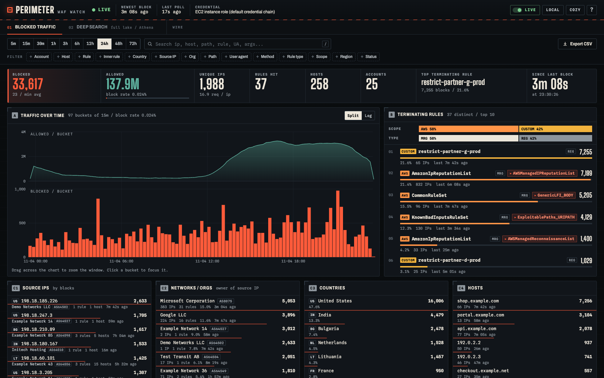
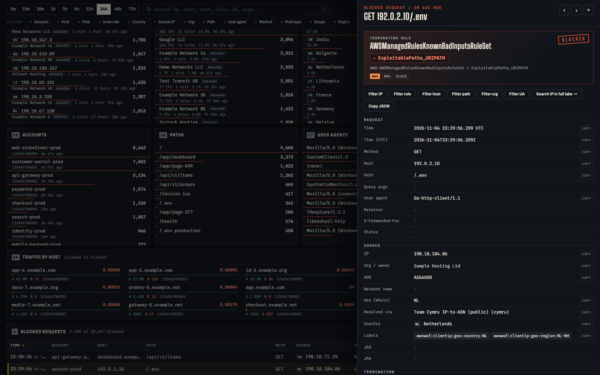
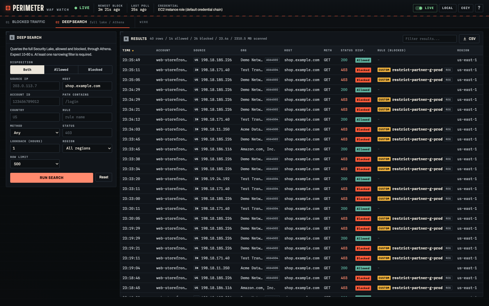
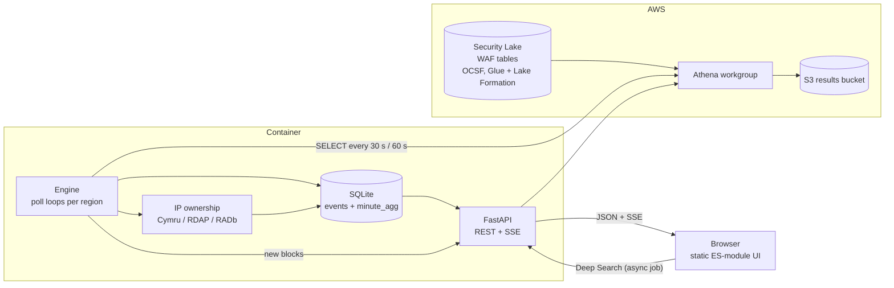

# Security Lake WAF Watch (Perimeter)

A self-hosted, near real-time dashboard for **AWS WAF logs stored in Amazon Security Lake**. It reads the
Security Lake WAF tables through Athena, keeps a rolling window in a local SQLite file, and serves a fast
filterable UI that shows, for every blocked request, **which rule terminated it** (the web ACL rule or rule group,
plus the specific inner rule when a managed rule group fired).



> The screenshots show a real deployment's data shape after anonymisation: every account, host, rule name, path,
> user agent and source IP was replaced by a placeholder (`example.com`, `198.18.0.0/15`, account IDs `1234567800xx`),
> and unrelated network owners were replaced by fictional names. The built-in demo mode (`WAF_DEV_FAKE=1`) produces a
> simpler, smaller data set with the same layout.

## Built with AI, designed by a human

This project was designed and directed by a human engineer and implemented almost entirely by AI coding agents.
The human made the architecture decisions (Security Lake as the only source, Athena as the query engine, rows for
blocked traffic and per-minute counts for allowed traffic, SQLite on a volume, strict query safety, no LLM at
runtime) and reviewed and tested the result against live data. The agents wrote the code, the tests and the UI.

The recommended model split if you want to extend it with an AI agent:

| Work | Suggested model |
|------|-----------------|
| Backend, tests, packaging, refactors | **Claude Sonnet** (fast, good at careful incremental coding) |
| UI and visual design (`app/static/`) | **Claude Opus** (stronger design judgment) |

You can also use the repo as-is without any AI. If you want an agent to rebuild or adapt it for you, give it
[`docs/ai-agent-rebuild.md`](docs/ai-agent-rebuild.md) (and [`AGENTS.md`](AGENTS.md) for day-to-day work).
No LLM is called by the running application.

## Features

- **Terminating rule for every block**: rule or rule group, rule type, and the inner managed rule
  (for example `AWS-AWSManagedRulesCommonRuleSet > GenericLFI_BODY`), plus match location and condition.
- **Near real time**: new blocks appear about 30 seconds after Security Lake publishes them (Security Lake itself
  lags the live traffic by a few minutes). Server-sent events push new rows to open browsers.
- **Traffic context without the cost**: allowed requests can be millions per hour, so they are stored only as
  per-minute counts per account and host. That gives block rate and traffic-by-host charts without storing rows.
- **Filter, sort, search**: account, host, rule, inner rule, country, source IP, network owner, path, user agent,
  method, rule type, scope, region and status, plus free-text search. State lives in the URL hash so views can be shared.
- **Source IP ownership**: organisation and ASN per source IP (public WHOIS sources, optional).
- **Deep Search**: an on-demand Athena query across the full lake (allowed and blocked, up to 24 hours) for questions
  the rolling window cannot answer. User input is validated and sent only as quoted Athena execution parameters.
- **Row drawer, CSV export, keyboard shortcuts**, UTC/local time toggle and a compact/cozy density toggle.
- **Safe by construction**: read-only queries, strict SQL guard, parameterised queries, Host allow-list, cross-site write
  protection, CSP headers, hash-locked dependencies, non-root read-only container.

| | |
|---|---|
|  |  |
| Row detail drawer with the full rule evaluation | Deep Search over the full lake |

A full-page capture is in [`docs/screenshots/dashboard-full.png`](docs/screenshots/dashboard-full.png).

## How it works



1. **Source**: the Security Lake WAF source (`waf_2_0`, OCSF) table per region, for example
   `amazon_security_lake_glue_db_us_east_1.amazon_security_lake_table_us_east_1_waf_2_0`.
2. **Engine** (`app/engine.py`): per region, one loop reads new *blocked* rows and one loop reads *per-minute counts*.
3. **Store** (`app/store.py`): SQLite in WAL mode on the `/data` volume. Detail rows for blocked requests, counts for
   everything, an IP ownership cache. Old data is pruned after the retention period.
4. **API** (`app/main.py`): FastAPI serves the filtered views, a server-sent-events stream and the static UI.
5. **UI** (`app/static/`): vanilla ES modules, no build step, no CDN, self-hosted fonts.

### Polling schedule

| Task | Interval | Details |
|------|----------|---------|
| Blocked rows, per region | every `WAF_POLL_SECONDS` (30 s) | Reads from the stored watermark minus 10 minutes, so late-arriving records are caught. Inserts are idempotent (`INSERT OR IGNORE` on the request id). |
| Per-minute counts, per region | every 60 s | Reads from the watermark minus 15 minutes, then replaces that window (`DELETE` + `INSERT`) so overlap never double counts. Group by `date_trunc('minute', time_dt)`, account, host, disposition. |
| First start (backfill) | back-to-back | Walks `WAF_BACKFILL_HOURS` (24) in 4-hour (rows) and 2-hour (counts) chunks, 0.2 s apart, until caught up. The UI shows a progress bar. |
| Credential and region probe | at start, every 30 min, 60 s while failing, immediately after 4 consecutive errors | A cheap `count(*)` over the last 10 minutes per region. Regions that fail are skipped and retried at the next probe, and the error is shown in the UI. |
| IP ownership worker | 0.5 s while there is work, otherwise every 10 s | Up to 200 new source IPs per batch, resolved with 12 parallel lookups. Unresolved IPs are retried after 30 minutes. |
| Pruning | every 10 min | Deletes rows older than `WAF_RETENTION_HOURS` (72). |
| Browser | SSE push; `/api/status` every 15 s; summary refresh every 60 s while live; table/summary/status polling every 30 s if SSE drops | Reconnection reloads missed rows. Table re-reads pending ownership cells every 15 s. Paused views stay paused. |

Failures back off by `min(60, 5 x consecutive_errors)` seconds. At most `WAF_ATHENA_CONCURRENCY` (3) Athena queries
run at once per process.

### Why blocked rows and allowed counts

On a busy organisation, allowed requests can exceed thousands per second while blocked requests are a tiny fraction.
Storing every allowed request would be costly and pointless for a "what is being blocked and why" dashboard, so
allowed traffic is reduced to counts. Counts were verified against direct Athena queries. If your volumes are
different, change the split in `app/queries.py` (decide per source after measuring).

More detail: [`docs/architecture.md`](docs/architecture.md).

## Quick start

### 1. Try the UI without AWS (synthetic data)

Python **3.12** is the supported and CI-tested version. Docker uses the same version.

```bash
python3.12 -m venv .venv && . .venv/bin/activate
pip install --require-hashes -r requirements.txt
cd app && WAF_DEV_FAKE=1 WAF_DATA_DIR=/tmp/wafdemo uvicorn main:app --port 8080
# open http://127.0.0.1:8080
```

### 2. Run against your Security Lake

Prerequisites:

- Amazon Security Lake enabled with the **AWS WAF** log source, in at least one region.
- An AWS principal that can run Athena queries on those tables. See [`docs/iam.md`](docs/iam.md) (IAM policy,
  Lake Formation grants, trust policies). **Lake Formation grants are the most common stumbling block.**
- An Athena workgroup and an S3 bucket for query results.
- Docker with the compose plugin on a host that has those credentials available (for example an EC2 instance with an
  instance profile).

```bash
cp .env.example .env
# edit .env: WAF_REGIONS, WAF_ATHENA_WORKGROUP, WAF_ATHENA_OUTPUT
docker compose up -d --build
docker compose logs -f waf-dashboard
# open http://127.0.0.1:8080  (the status strip at the top shows which credentials and regions work)
```

On first start the dashboard backfills 24 hours, which takes a few minutes depending on volume.

> **No built-in user management.** The container binds to `127.0.0.1` by default. To expose it, put it behind a VPN,
> security group allow-list, or an authenticating reverse proxy (ALB with OIDC, oauth2-proxy, and so on), set
> `WAF_BIND=0.0.0.0`, and list the name users type in the browser in `WAF_ALLOWED_HOSTS` (other Host headers get 400).
> For small deployments there is an optional shared `WAF_BASIC_AUTH=user:password` gate; only use it over HTTPS.
> See [Security](#security).

## Credentials

The app uses the **standard AWS credential chain** (boto3), so it works with whatever your host provides. Nothing
in the code is tied to one mechanism:

| Where it runs | What to do |
|---------------|------------|
| EC2 | Attach an instance profile. Containers need IMDSv2 hop limit 2; see the region-scoped setup command in [`docs/iam.md`](docs/iam.md). |
| ECS / EKS | Use a task role or IRSA / Pod Identity. Nothing else to configure. |
| Anywhere else | Provide `AWS_ACCESS_KEY_ID` / `AWS_SECRET_ACCESS_KEY` / `AWS_SESSION_TOKEN` in the environment, or mount a shared config (see below). |
| Profiles, SSO, IAM Roles Anywhere, any `credential_process` | Set both AWS config/credentials file paths and select `WAF_AWS_PROFILE`. SSO also needs its cache under the container user's home. Follow [`docs/iam.md`](docs/iam.md), including uid 10001 file permissions. External signing helpers are not included. |
| Role in another account | Set `WAF_ASSUME_ROLE_ARN` (and optionally `WAF_ASSUME_ROLE_EXTERNAL_ID`). The app assumes it with the base credentials and refreshes it automatically. |

## Configuration

All settings are environment variables (see [`.env.example`](.env.example)). Compose forwards the application
settings below except `WAF_DATA_DIR`, which stays `/data` to match the persistent volume. Docker Compose does not
pass arbitrary shell variables into a container; AWS environment credentials are explicitly forwarded.

| Variable | Default | Purpose |
|----------|---------|---------|
| `WAF_REGIONS` | `us-east-1` | Comma separated Security Lake regions to read. |
| `WAF_ATHENA_WORKGROUP` | `primary` | Workgroup used for every query. |
| `WAF_ATHENA_OUTPUT` | empty | `s3://<ATHENA_RESULTS_BUCKET>/waf-dashboard/`; `{region}` is substituted. Leave empty only if the workgroup enforces an output location. |
| `WAF_SL_DB_TEMPLATE` | `amazon_security_lake_glue_db_{region_u}` | Glue database name template. |
| `WAF_SL_TABLE_TEMPLATE` | `amazon_security_lake_table_{region_u}_waf_2_0` | Glue table name template. |
| `WAF_AWS_PROFILE` | empty | Named AWS profile instead of the default chain. |
| `WAF_ASSUME_ROLE_ARN`, `WAF_ASSUME_ROLE_EXTERNAL_ID` | empty | Optional extra assume-role hop. |
| `WAF_POLL_SECONDS` | `30` | Blocked-row polling interval. |
| `WAF_AGG_SECONDS` | `60` | Per-minute count polling interval. |
| `WAF_BACKFILL_HOURS` | `24` | History loaded on first start. |
| `WAF_RETENTION_HOURS` | `72` | How long data is kept (also the maximum UI window). |
| `WAF_ATHENA_CONCURRENCY` | `3` | Concurrent Athena queries. |
| `WAF_ACCOUNTS_FILE` | empty | JSON object `{"<account id>": "<friendly name>"}`; see `accounts.example.json`. |
| `WAF_RULE_STRIP_PREFIXES` | empty | Comma separated prefixes hidden from rule names in the UI. |
| `WAF_WHOIS` | `public` | `public` looks up source IP owners (Team Cymru, RDAP, RADb); `off` disables. |
| `WAF_BIND`, `WAF_PORT` | `127.0.0.1`, `8080` | Host binding for the published port. |
| `WAF_ALLOWED_HOSTS` | `localhost,127.0.0.1,::1` | Accepted `Host` header names (exact, `*.example.com`, or `*`). Required when exposing beyond loopback. |
| `WAF_BASIC_AUTH` | empty | Optional `user:password` gate. Password at least 12 characters; a malformed value stops the app. |
| `FORWARDED_ALLOW_IPS` | `127.0.0.1` | Proxy addresses whose `X-Forwarded-For` is trusted (uvicorn setting). |
| `WAF_SEARCH_PER_CLIENT_HOUR`, `WAF_SEARCH_GLOBAL_HOUR` | `30`, `120` | Deep Search start limits. |
| `WAF_SEARCH_DAILY_SCAN_GB` | `0` (off) | Stop accepting Deep Searches after this much data scanned per UTC day. |
| `WAF_MAX_STREAMS` | `50` | Concurrent live (SSE) connections. |
| `WAF_API_QUERY_TIMEOUT` | `15` | Seconds an API request may spend in SQLite before it gets 503. |
| `WAF_DATA_DIR` | `/data` | SQLite location inside the container. |
| `WAF_DEV_FAKE` | unset | `1` runs with synthetic data and no AWS access. |

**Privacy note on WHOIS:** with `WAF_WHOIS=public`, the *source IP addresses of blocked requests* (external clients)
are sent to Team Cymru, RDAP and RADb. Private and reserved addresses are labelled locally and never leave the host.
Set `WAF_WHOIS=off` if that is not acceptable.

## Cost and performance

- Athena is billed per byte scanned. The poller issues a small number of queries per minute per region; the
  header tooltip and `/api/status` (`athena_queries`, `athena_scanned_mb`) report what the running instance has scanned,
  so you can measure on your own data. Reduce cost by increasing `WAF_POLL_SECONDS` / `WAF_AGG_SECONDS`, limiting `WAF_REGIONS`,
  or tightening partition pruning in `app/queries.py` for your table layout.
- Deep Search is rate limited (30 per hour per client, 120 per hour in total, 4 concurrent), limited to 24 hours and
  2,000 rows, requires at least one narrowing filter, and can be capped per day with `WAF_SEARCH_DAILY_SCAN_GB`.
  These counters reset on restart and are not a billing cap for polling. Partial regional searches explicitly
  report `partial`, `searched_regions` and `skipped_regions`; an unavailable selected region is an error.
- One uvicorn worker on purpose: the ingest loops and SSE fan-out live in the process.
- SQLite with WAL handles the stored window comfortably; the container is limited to 1 GiB / 1.5 CPU by default.

## HTTP API

The UI is a client of the same JSON API, so you can script against it.

| Endpoint | Purpose |
|----------|---------|
| `GET /healthz` | Liveness. |
| `GET /api/status` | Credential/region state, per-stream errors, retention health, freshness, backfill progress, Athena usage. |
| `GET /api/summary` | KPIs, time series, top lists (rules, IPs, orgs, hosts, accounts, countries, paths, user agents). |
| `GET /api/events` | Paged rows. `sort`, `dir`, `limit` (max 500), `offset`. |
| `GET /api/events/{id}` | Full detail for one row. |
| `GET /api/facets` | Values for the filter pickers. |
| `GET /api/export.csv` | CSV of the current filter (50,000 rows max, formula-injection safe). |
| `GET /api/stream` | Server-sent events (`blocked`, `tick`). |
| `POST /api/search`, `GET /api/search/{id}` | Deep Search job start and poll. |

Common filter parameters: `range` (`5m`...`72h`) or `from`/`to` (epoch ms), repeatable `account`, `host`, `rule`,
`inner_rule`, `country`, `ip`, `org`, `path`, `ua`, `method`, `rule_type`, `scope`, `region`, `status`, and `q`.

## Repository layout

```
app/
  main.py        FastAPI app, filters, API, CSV export, SSE, Deep Search jobs, security headers
  engine.py      credential probe, ingest loops, SSE pub/sub, IP ownership worker, status
  athena.py      Athena runner (SELECT-only guard, quoted execution parameters, polling with backoff, concurrency limit)
  queries.py     fixed SQL templates for the Security Lake WAF table
  store.py       SQLite schema, enrichment of raw rows, rule classification, pruning
  whois.py       public IP-to-organisation lookups
  config.py      environment configuration
  devfake.py     synthetic demo data (WAF_DEV_FAKE=1)
  static/        the UI (HTML, CSS, ES modules, fonts)
docs/            architecture, IAM, AI rebuild guide, screenshots
.github/         CI workflow (tests + dependency audit)
scripts/         screenshot helper for demo mode
tests/           unit tests (no AWS needed)
Dockerfile, docker-compose.yml, .env.example, accounts.example.json
requirements.in / requirements.txt (runtime, hash-locked)
requirements-dev.in / requirements-dev.txt (test and audit tools, hash-locked)
SECURITY.md, CONTRIBUTING.md, CHANGELOG.md
```

## Development

```bash
python3.12 -m venv .venv && . .venv/bin/activate
pip install --require-hashes --only-binary :all: -r requirements-dev.txt
python -m unittest tests.test_backend        # no AWS access needed
node --experimental-vm-modules --test tests/test_frontend.mjs   # Node 22+, no npm install
pip-audit -r requirements.txt --require-hashes --disable-pip
```

The tests drive the ingest path with a stub Athena runner and cover rule classification, the SQL guard, Athena
parameter quoting, literal path filters, input validation, the Host/Origin guard, the auth gate (including the
Host-header bypass regression), CSV export, query time limits, concurrent search admission, partial regional
results, ownership retries, independent ingest recovery, retention recovery and application lifecycle.
Frontend regressions cover stream fallback/reconnect, paused views, custom-window facets and partial-result warnings.

### Dependencies

`requirements.in` lists the direct dependencies; `requirements.txt` is the fully pinned, hash-locked set that the
image installs with `pip install --require-hashes`. To upgrade, edit `requirements.in` and regenerate inside the
same base image so the hashes match the build platform:

```bash
docker run --rm -v "$PWD":/src -w /src python:3.12-slim sh -c \
  "pip install -q pip-tools && pip-compile --generate-hashes --allow-unsafe --strip-extras --no-header -o requirements.txt requirements.in"
```

`requirements-dev.in` adds pinned test/audit tools to the same runtime dependencies; its generated
`requirements-dev.txt` is also hash-locked. Regenerate it after changing either manifest, preserving the runtime pins:

```bash
pip-compile --generate-hashes --allow-unsafe --strip-extras --no-header \
  --constraint requirements.txt -o requirements-dev.txt requirements-dev.in
```

The base image is pinned by digest in the `Dockerfile`. CI (`.github/workflows/ci.yml`) runs backend and frontend
regressions, `pip-audit`, and a hardened container startup smoke test using synthetic data only.
See [`CONTRIBUTING.md`](CONTRIBUTING.md) for contribution expectations and [`CHANGELOG.md`](CHANGELOG.md) for changes.
Deployment, reverse-proxy and recovery procedures are in [`docs/operations.md`](docs/operations.md).

## Security

Threat model: the dashboard holds WAF log data (client IPs, paths, query strings, user agents) and can spend Athena
money through Deep Search. **Whoever can reach the port can see all of it.** Network placement and the proxy in front
of it are the primary controls; the app adds defence in depth:

- Read-only against AWS; the Athena runner accepts a single `SELECT`/`WITH` statement only, and user input is validated
  and passed as quoted execution parameters (never concatenated into SQL).
- `Host` allow-list (DNS rebinding), rejection of cross-site non-GET requests (`Origin` / `Sec-Fetch-Site`),
  `application/json` required on POST.
- Optional basic auth that fails closed on a bad config value, uses constant-time comparison, logs failures and throttles
  a client after 10 failures in 5 minutes. Access decisions use the routed ASGI path, not a URL rebuilt from `Host`.
- Strict CSP and security headers; the UI never uses `innerHTML`; CSV export defuses spreadsheet formulas.
- Database work runs off the event loop with a per-request time limit; caps on live connections, export size and Deep Search.
- Non-root, read-only container with dropped capabilities; hash-locked dependencies; base image pinned by digest.

By design, `/api/status` shows the AWS identity, regions and raw Athena errors, and the row drawer shows full request
details (including query strings). These are the operator's own data and are what make the tool useful for diagnosis;
restrict who can reach the dashboard rather than hiding them. If you put a reverse proxy in front, have it pass the
original `Host` header (nginx: `proxy_set_header Host $host;`) and set `FORWARDED_ALLOW_IPS` to its address.

Please report vulnerabilities privately; see [`SECURITY.md`](SECURITY.md).

## Troubleshooting

| Symptom | Likely cause and fix |
|---------|----------------------|
| Banner "cannot read Security Lake", `TABLE_NOT_FOUND` for a table that exists | Lake Formation does not grant your role `DESCRIBE`/`SELECT`. IAM alone is not enough. See [`docs/iam.md`](docs/iam.md). |
| `AccessDenied` on `StartQueryExecution` | The role lacks Athena permissions on the workgroup in `WAF_ATHENA_WORKGROUP`. |
| `No output location provided` | Set `WAF_ATHENA_OUTPUT` or configure the workgroup's result location. |
| "Unable to locate credentials" in a container on EC2 | IMDS hop limit is 1. Set it to 2 (see Credentials). |
| Credential probe hangs or DNS errors with a custom Docker network | Use the default bridge network or fix the network's DNS. |
| No data for a region | Check the Glue database/table names (`WAF_SL_*_TEMPLATE`) and that WAF logs reach Security Lake in that region. |
| Counts look a few minutes behind | Expected: Security Lake publishes with a delay of a few minutes. |
| `host not allowed (see WAF_ALLOWED_HOSTS)` | Add the name or address in the browser's address bar to `WAF_ALLOWED_HOSTS`. Behind a proxy, make it forward the original `Host`. |
| `cross-site request rejected` on Deep Search | The proxy changes `Host` so it no longer matches the browser's `Origin`; forward the original `Host`. |
| Container exits with `WAF_BASIC_AUTH must be 'user:password'...` | Fix the value (password of 12+ characters) or unset it. |

## License

MIT, copyright 2026 Security Lake WAF Watch contributors. See [`LICENSE`](LICENSE).
The container includes the application license at `/usr/share/licenses/waf-dashboard/LICENSE`.
Fonts retain their separate SIL Open Font License; see
[`app/static/fonts/LICENSE-fonts.txt`](app/static/fonts/LICENSE-fonts.txt).
